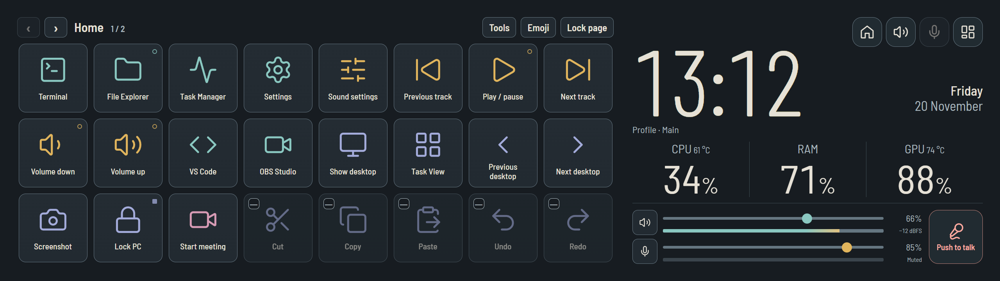
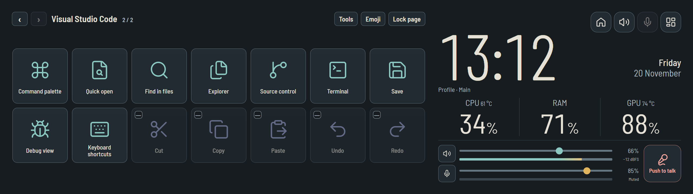
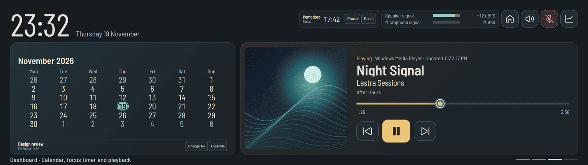

# Lastra

Lastra turns the **CORSAIR XENEON EDGE** into a touchscreen macro deck for Windows 10 and 11. **Switch apps and Lastra automatically loads the shortcuts for the new foreground app.** Run macros and keep the Windows mixer, media controls, and system telemetry within reach. Lastra runs on Electron and works while iCUE is closed.

[Download for Windows x64](https://github.com/FabioRM/lastra-deck/releases/latest) · [Project site](https://fabiorm.github.io/lastra-deck/) · [Changelog](CHANGELOG.md) · [Report an issue](https://github.com/FabioRM/lastra-deck/issues)



Bring an app like Visual Studio Code to the foreground and Deck Keys opens its shortcut page. Assign your own pages in the editor or use the included shortcut packs.

[Getting started](#getting-started) · [Deck views](#deck-views) · [Profile editor](#profile-editor) · [Local MCP integration](#local-mcp-integration) · [License](#license)

<details>
<summary>Visual Studio Code, Dashboard, and portrait previews</summary>





<a href="docs/preview-portrait.png"></a>

</details>

## Getting started

Set the XENEON EDGE to **Extend these displays** in Windows Display settings. The panel runs at 2560 × 720 in landscape and 720 × 2560 in portrait.

**Install the app.** Download `Lastra-Setup-<version>.exe` from the [latest GitHub release](https://github.com/FabioRM/lastra-deck/releases/latest). The installer runs on Windows x64, installs for the current user without administrator rights, and adds Start menu and desktop shortcuts. The initial public installer is unsigned, so Windows SmartScreen may show a warning. The release includes a SHA-256 checksum you can compare with `Get-FileHash .\Lastra-Setup-<version>.exe -Algorithm SHA256` in PowerShell.

Installed copies download updates from GitHub Releases in the background and install them when Lastra quits. **Lastra → Settings → System → Updates** offers an immediate check and shows when a restart can install the update. Set `LASTRA_DISABLE_UPDATES=1` to turn update checks off. Settings and profiles live in `%APPDATA%\Lastra` and survive updates and uninstalls.

**Run from source.** Clone the repository or download the source archive from the release. Install **Node.js 22.12.0 or later**, then run these commands from the project directory. To build the installer yourself, see [Releasing](docs/releasing.md).

```powershell
npm ci
npm start
```

Lastra looks for the XENEON EDGE among the displays detected by Windows. The deck opens in a borderless, always-on-top window with activation disabled. If the Edge is absent at startup or disconnected during use, Lastra closes along with any hardware monitoring it started. While the Edge is connected, use **Lastra → Settings → Display → Display, activity and navigation options** or `npm start -- --display=<id>` to move the deck to another monitor. `npm run dev` opens a diagnostics window even when the Edge is absent.

Click the Lastra icon in the Windows notification area to open desktop Settings. The right-click menu offers **Lastra**, **Avvio automatico**, **Info**, and **Esci**. Enable **Avvio automatico** to launch Lastra when you sign in. The setting is optional and also appears under **Startup apps** in Windows. If the Edge is disconnected when you sign in, Lastra exits. Connect it and start Lastra manually.

When Windows changes the display layout, rotates the screen, or wakes from sleep, Lastra rechecks the display after a short delay and puts the deck back without taking focus. A brief interruption while Windows detects the Edge can recover in the same window. If Lastra has already exited after a disconnect, reconnect the Edge and start Lastra again.

Lastra opens **Dashboard** on first launch. The switch in the top-right corner cycles through **Deck Keys → Dashboard → Stats**. Later launches restore the last manually opened view, selected deck page, and page lock.

The **Speakers** and **Windows microphones** icons stay next to the view switch on **Dashboard** and **Deck keys**. Use them to mute the default Windows output or mute and restore the Windows inputs as a group. They reflect changes made in Windows.

### Mapping touch to the XENEON EDGE

In **Lastra → Settings → System → Diagnostics and deck maintenance**, **Touch diagnostics** shows which monitor receives touch events, with physical coordinates and DPI. **Configure Windows touch** opens **Tablet PC Settings**. You can also open it through Control Panel or with `control.exe /name Microsoft.TabletPCSettings`.

1. Select **Setup**. If Windows asks for the input type, choose **Touch input**.
2. Press **Enter** to skip the other monitors.
3. When the white prompt appears on the XENEON EDGE, tap the display once with one finger. If setup continues on another monitor, press **Enter** to skip it.
4. Return to Lastra and try changing pages with a touch. The layout also adapts when you rotate the display to portrait.

Use **Export diagnostics…** under **Settings → System → Diagnostics and deck maintenance** to save a JSON report for troubleshooting. It includes display geometry and touch mapping, audio mute and volume status, sensor availability, and integration status. Service health appears as totals. The report omits device names and IDs, file paths, URLs, credentials, media titles, and profile contents. Export reads the current state without starting providers or sending the report anywhere.

## Deck views

- **Deck Keys** combines app-aware shortcut pages, a persistent widget bar, and Windows audio controls. The default **Home** fits the 19 shortcuts and five fixed editing keys on one screen in either orientation. [Shortcut packs](docs/shortcut-packs.md) · [Macros](docs/macros.md) · [Widgets](docs/widgets.md)
- **Tools** opens a dedicated screen from Deck Keys with countdowns, a stopwatch, Pomodoro, Quick decision, the soundboard, and deck controls. Open **Pages** or **Apps** from Tools. Set the Quick decision pick list in **Tools settings** in the desktop editor.
- **Dashboard** shows a clock, calendar, Pomodoro timer, and Now Playing for the default Windows media session. Use **Previous**, **Play or Pause**, and **Next**, or drag the progress bar to seek when supported. [Now Playing](docs/now-playing.md) · [Pomodoro](docs/pomodoro.md)
- **Stats** shows current readings and one-minute graphs for the processor, graphics, memory, displays, app frame performance, storage, and cooling. [Telemetry guide](docs/telemetry.md)
- **OBS** shows live recording and streaming status and provides controls for scenes and sources. [OBS setup](docs/obs.md)
- **Apps** offers searchable, pinnable views for Spotify, Docker and Compose, Kubernetes, GitHub Checks, WSL, Windows Terminal, and custom apps. **Action history** shows up to 100 completed command attempts from the current session. [App views](docs/app-views.md) · [Kubernetes](docs/kubernetes.md) · [GitHub Checks](docs/github-checks.md)
- **Emoji** puts frequently used emoji at the top of one vertically scrollable grid. Swipe up or down, use the mouse wheel, or search with the touch keyboard. Tap an emoji to insert it into the active text field.


Under **Settings → Display → Display, activity and navigation options**, **Dashboard calendar** lets you choose what opens when you tap the calendar. Choose Google Calendar, Outlook.com Calendar, or Microsoft 365 Calendar to open it in your default browser. **Do nothing** is the default.

In **Apps**, open **Service health** to track the HTTP, TCP, DNS, and ping checks you configure. Use **Lastra resources** to see CPU and memory usage for Lastra and its managed helpers, or **Web embeds** to open approved HTTPS pages and official Spotify embeds. [Service health](docs/service-health.md) · [Resource monitoring](docs/resources.md) · [Web embeds](docs/web-embeds.md)

Open **Battery and power** in **Apps** to check Windows battery charge and runtime or add a local UPS status source. [Battery and power guide](docs/power.md)

Open **Monitoring watchlist** in **Apps** to keep selected hardware, app, and service readings together. [Monitoring watchlist guide](docs/watchlist.md)

## Pages and keys

- Use the arrows, swipe horizontally, scroll sideways on a trackpad, or turn the mouse wheel over Deck Keys to change pages. A swipe cancels the key where it started. **Home** returns to the first page. The default profile starts on **Home**. VS Code and each browser open their own automatic shortcut pack when they take focus.
- Deck opens a configured page for the foreground Windows app when one exists. Otherwise, it uses a matching built-in shortcut pack or a temporary **Auto** page with common shortcuts. Use a page's **Windows app IDs** for an exact Store app or installed web app match. Browser packs cover ordinary browser tabs. [Shortcut pack guide](docs/shortcut-packs.md)
- A page's **Context rules** can match a project or document within an assigned executable or Windows app ID. Lastra takes the highest **Rule priority**, then the most specific match. At equal priority, exact titles beat prefixes and partial titles, and Windows app IDs beat executable names for otherwise equal rules. Page order resolves a tie. Tap the page count or **Auto** to see why the page opened.
- Use **Home** or either arrow from an **Auto** page to return to a configured page. A manual selection holds until the foreground app changes. **Lock page** keeps the displayed page until you unlock it. If an automatic page is locked when Lastra closes, the configured fallback opens locked next time.
- In Lastra Settings, open **Display, activity and navigation options → After an app page** to choose **Home** or **Last manually selected page**. The deck uses this choice when the foreground stops matching an app page. It keeps the last manual page for each activity. The default is **Last manually selected page**.
- To see the desktop behind the deck, select **Reveal desktop** in Tools or in **Display, activity and navigation options**. **Restore Lastra** returns to the previous view, page, and lock setting. Display settings also offer an optional swipe up from the bottom edge of Deck Keys.
- Open **Tools → Pages** to jump to a saved page. Set favorites in **Lastra → Settings → Display → Deck organization**. Each activity keeps its own favorites and six most recently opened pages.
- In the editor, set a page’s **Folder path** to group its keys, for example `Work / Editing`. Deck Keys shows the current folder below the page name. **Pages** opens that folder and lets you tap a parent, **All pages**, or **Home**.
- Switch between **Main**, **Work**, **Meeting**, **Gaming**, and **Streaming** from Deck Keys or **Activity profile** in **Display, activity and navigation options**. Each stores its own pages, backups, and navigation. An open editor continues to save to the activity shown in its title.
- A contextual page binds to the foreground window that it represents. Switching windows cancels pending gestures and queued work for the previous deck revision. A locked contextual page stays visible and reads **Target inactive** until its window returns. Lastra rechecks the window before each keyboard step in a contextual macro.
- The **Apps** catalog opens separately. Its **Follow foreground** setting is optional.
- A circle marks a **long press** of 550 ms. A dash marks a **double tap**. For double-tap keys, Lastra waits up to 320 ms before running the single-tap action.
- A square marks a key that requires confirmation. **Lock PC** uses **Hold to confirm** on the default Home page. Browser packs also require confirmation to close a tab. Release early or move off the key to cancel a hold.
- A key's corner indicator shows whether its action is running, succeeded, failed, or is unavailable. Tap the indicator to see the result, queue status, or reason, including individual macro steps when available.

In the profile editor, expand **Profile settings** to change gesture timing or cancellation distance. Select **Apply gesture settings**, then save the profile to apply the changes to the deck.

Use a key's **Confirmation** setting for actions that need an extra check. **Hold to confirm** uses the profile's duration unless you override it on that key. **Ask before running** opens a dialog with **Run action** and **Cancel**. Escape also dismisses the dialog. If the page or foreground window changes, open the confirmation again before running the action.

Use **Wait for state**, **If / else**, and per-step failure handling to coordinate sequences with Windows or OBS. [Conditional macros](docs/macros.md)

Each key's **While running** setting controls what happens when you use it again before its action finishes. **Ignore extra presses** is the default. **Queue one press** saves the first extra gesture and discards further presses while it waits. The queued action is dropped if the page or profile changes, the deck closes or reloads, or a different window is active when it would start.

## Audio and system indicators

The sliders at the bottom right of Deck Keys adjust the default speaker volume and the selected microphone level through Windows Core Audio. Tap the microphone icon beside its slider to choose an input. Choose **All microphones** to adjust every active input together. A reading prefixed with ≈ shows the average when the inputs have different levels.

Tap the speaker icon beside its slider to open **App mixer** and adjust individual Windows apps. It fills the space below the clock and leaves the shared mute icons available. A row controls all listed audio sessions for that app, including sessions routed to different speaker outputs. A volume prefixed with ≈ indicates an average across different session levels. Lastra refreshes the mixer every second while it is open. Use **Deck organization → Pinned mixer apps** in Lastra Settings to keep a fader at the top, even after its audio session closes. Offline controls are disabled and become available again when the same app opens a session. **Unpin** also works offline.

The top-right speaker and microphone buttons toggle mute. Hold the speaker button to choose the Windows playback device. With the button focused, press **Down Arrow** or **Shift+F10** to open the same picker. The list refreshes while open, marks the default output, and shows disconnected or disabled devices reported by Windows. Selecting an available device sets the default output for ordinary Windows audio. The microphone button and the **Windows mic** key mute every active input, including inputs selected directly by another app. Tap again to restore the inputs Lastra muted. If every input was already muted, Lastra unmutes the default communications microphone. The Teams and Meet shortcuts apply to the respective app in the foreground.

Speaker and microphone keys show the latest Windows mute state, including **Partly muted** for a mixed microphone group. Spotify playback keys show the state of the current desktop media session. The standard icons and labels adapt to the current state, while custom icons, images, and labels stay visible. These indicators follow changes made outside Lastra and are available on pages and the persistent bar.

The editor's **Key value** setting controls the small readout on a key. Audio and Spotify keys show volume or time remaining by default. A key can also show CPU, GPU, or RAM usage, or a CPU or GPU temperature when a sensor is available. Use **Off** to hide the numerical value.

Dashboard shows the **Signal** card alongside the top-right controls. In Deck Keys, each channel shows its live peak in dBFS directly beneath the volume percentage. The speaker bar follows the current Windows playback device. The microphone bar follows the loudest unmuted input automatically. Choose an individual microphone in Deck Keys to meter only that input. The bars distinguish silence, mute, and unavailable readings.

Open **Apps → Audio presets** to save the current Windows speaker and default microphone levels for an activity. The preset displays the current and saved values side by side. **Apply shown levels** verifies that the same devices and levels are still present, then checks Windows readback for each change. Use **Refresh levels** after changing a volume or device in Windows. Presets affect volume only.

Open **Lastra → Settings → Display** to preview and choose **System**, **Light**, **Dark**, **Midnight**, **Forest**, or **Ember**. **System** follows Windows appearance as it changes. Choose a custom **Accent color** or use the palette's original accent. High contrast takes precedence over custom colors. The settings apply to the deck, profile editor, and preview.

In **Settings → PC telemetry** or **Deck settings → Telemetry** in the editor, choose **Number** or **Gauge** independently for CPU, RAM, and GPU in the deck side panel. You can also show or hide percent signs and clock seconds. Percent signs are on by default and clock seconds are off. Readings that reach 100% display **MAX** in red.

Select a muted input and hold the square **Push to talk** button to open that microphone. **Talking** confirms that Windows has unmuted the input. [Push-to-talk guide](docs/push-to-talk.md)

CPU and RAM update automatically. For GPU and temperature readings, install the portable version of LibreHardwareMonitor with WinGet.

```powershell
winget install --id LibreHardwareMonitor.LibreHardwareMonitor --exact --scope user --skip-dependencies
```

Lastra loads the official library in a background process and samples sensors every two seconds. The process starts only while the Edge is connected and exits with Lastra. For a manually installed portable copy, set `LASTRA_LHM_DIR` to the folder containing the .NET Framework build of `LibreHardwareMonitorLib.dll`. Some temperature readings require access to the sensor driver. If you run an independent LibreHardwareMonitor instance, Lastra can still read `http://127.0.0.1:8085/data.json`. [LibreHardwareMonitor](https://github.com/LibreHardwareMonitor/LibreHardwareMonitor)

The Deck side panel shows the current CPU, RAM, and GPU readings. Add a **System metric** graph widget when you want to see a history chart. [Telemetry guide](docs/telemetry.md)

## Interface language

Use **Lastra → Settings → System → Interface language** to choose **System language**, **Italiano**, or **English**. Lastra defaults to the first supported language in Windows preferences and falls back to English. Changing the interface language keeps the current draft and undo history. Key and page names, the Office shortcut language, and the profile's date and time format are stored in the profile. Specialized messages without an Italian translation appear in English.

## Profile editor

Select **Editor** in the desktop Lastra window or run `npm run edit`. Choose a page on the left, then select a slot in the grid to edit its **Actions**, **Style**, or **Placement**. Use the arrow keys to move around the grid or drag a key to move it. Expand **Page settings** to set the apps that activate the page. **Save profile** updates the deck immediately. Find profile import, export, and backups under **More**.

Open **Settings → Display** to set the display theme, text size, contrast, clock, idle screen, and dimming. Enable **Large Deck Keys** for bigger, more widely spaced touch targets. Use the page arrows or swipe to reach additional keys, and find Cut, Copy, Paste, Undo, and Redo at the end of each screen. The page layout shows how many screens each orientation needs. These global settings apply when changed.

Open **Settings → Keyboard shortcuts** to assign Windows-wide combinations for Next, Previous, a saved page in this activity, a view, Back to the last page, or Reveal/Restore. Each row shows whether it registered. If a combination is already assigned or Windows cannot register it, change the shortcut or select **Apply** again after it becomes available. The page lock pauses page shortcuts. View-only mode and Windows lock pause every shortcut.

On a key, select **Choose icon or image** to search Lucide, browse Start menu apps, or select an image or Windows executable. The crop controls preview the square image before applying it to the draft. Undo and Redo include this change. Save embeds the crop as a PNG in the profile.

Choose **Templates** to preview Work, VS Code, Meetings, Streaming, Video and image editing, or Sim racing. Adding a template creates independent pages in the current draft and assigns unused app matches. Existing pages keep their matches. Use Undo to remove the addition, or save the profile to make the pages available on the deck.

Select **Browse actions** beside an action’s **Type** field to search by name, category, or example. Choose a result to open its settings. You can also use the **Type** picker directly.

Use **Page widgets** or **Bar widgets** to add Now Playing, system readings, and timers. The catalog previews each widget and checks its placement before you save. [Widget guide](docs/widgets.md) · [Timers](docs/timers.md) · [Soundboard](docs/soundboard.md)

Copy keys and pages to the Windows clipboard and paste them into other profiles. Use **Duplicate** to reuse actions in the current profile. Added pages have new IDs and can be associated with executables for automatic switching.

Use **Undo** and **Redo** in the toolbar or press **Ctrl+Z**, **Ctrl+Y**, or **Ctrl+Shift+Z**. Typing in one field is grouped into short edits. Saving keeps the undo history and marks the saved version as clean. Reloading from disk starts a new history.

Expand **Live preview** above the page layout to see the current page and persistent widget bar as you edit. Switch between the native 2560 × 720 landscape and 720 × 2560 portrait aspect ratios. The preview updates before you save, uses sample readings, and disables deck actions.

On first launch, Lastra copies `profiles/default.json` to `%APPDATA%\Lastra\profile.json`. Open it from **Settings → System → Profile files** to edit it directly. If the profile is missing or invalid, Lastra keeps using the last valid configuration when available. Each save backs up the previous valid profile as `profile.json.bak`. When you repair a malformed file, the editor keeps the malformed version as `profile.json.invalid`. If another app changes the file while you are editing, reload it in the editor before saving or restoring.

**Backups** in the profile editor lists earlier versions and can restore one to the deck. Lastra keeps up to ten distinct recent versions, including the active one, in `profile.json.history`. This includes valid external edits that Lastra loads. An existing backup from before the English upgrade is also available. Restore asks for confirmation before replacing the active profile or discarding unsaved edits.

Profiles from 0.1 with top-level `keys` open as a **Home** page. The editor saves them in the page-based format. To try a 0.2 profile alongside an existing installation, pass a separate copy with `npm start -- --profile=C:\path\profile.json`.

Stock profiles ship with English labels. The unchanged original stock profile upgrades to that version and is backed up as `profile.json.before-english.bak`. Custom profiles retain their labels and locale. The `locale` field controls date and time formatting.

At startup, Lastra retires untouched copies of the original VS Code and Browser pages from the Main activity. It keeps customised pages and saves a copy of the original profile in `profile.json.before-automatic-pages.bak`. If the saved selection referred to a retired page, Lastra falls back to the first page and keeps the existing lock setting.

An untouched older **Home** in the Main activity is compacted to the single-screen layout. The original profile is available in **Backups** and in `profile.json.before-compact-home.bak`.

### JSON format

```json
{
  "name": "Main",
  "locale": "en-GB",
  "grid": { "cols": 8, "rows": 3 },
  "pages": [
    {
      "id": "home",
      "name": "Home",
      "keys": [
        {
          "id": "explorer",
          "label": "File Explorer",
          "icon": "folder",
          "category": "app",
          "action": { "type": "launch", "target": "explorer.exe" },
          "hold": { "type": "open", "target": "%USERPROFILE%\\Downloads" }
        },
        null
      ]
    },
    {
      "id": "browser",
      "name": "Browser",
      "apps": ["chrome.exe", "msedge.exe"],
      "keys": [
        {
          "id": "tab",
          "label": "New / reopen tab",
          "icon": "square-plus",
          "action": { "type": "hotkey", "keys": "ctrl+t" },
          "double": { "type": "hotkey", "keys": "ctrl+shift+t" }
        }
      ]
    }
  ]
}
```

Pages inherit the profile grid. Set a page's own `"grid": { "cols": 5, "rows": 2 }` to override it. The editor provides these controls under **Page grid**. A key can cover several cells from its anchor, for example with `"span": { "cols": 2, "rows": 1 }`. Leave the covered array entries as `null`. Widgets fit in the remaining cells. Use **Width in cells** and **Height in cells** to set a key's size in the editor.

`hold` and `double` are optional actions. Set `"confirm": { "mode": "prompt" }` for a confirmation dialog or `"confirm": { "mode": "hold", "holdMs": 850 }` for a key-specific hold of 250 to 3000 ms. Omit `holdMs` to use the profile duration. Existing `"confirm": true` keys also use the profile duration. A confirmed key cannot have `hold` or `double` actions. The optional `onBusy` field accepts `ignore` or `queue-one`. Use `icon` for a Lucide icon name or `image` for the path to a PNG, JPG, SVG, or WebP up to 2 MB. Available categories are `app`, `media`, `system`, and `meeting`. [Lucide icon catalog](https://lucide.dev/icons)

### Action fields

| Action | Fields |
|---|---|
| `launch` | `target` executable, optional `args` list, optional `cwd` directory, optional `reuseWindow` boolean |
| `open` | `target` URL, Windows URI scheme, or path |
| `workspace` | `workspace` set to the ID of a configured workspace |
| `hotkey` | `keys` combination such as `ctrl+shift+m` |
| `media` | `key` chosen from `playpause`, `next`, `prev`, `stop`, `mute`, `volup`, `voldown` |
| `text` | Unicode `text` to type |
| `delay` | `ms` from 0 to 10000 |
| `wait-for` | `condition`, `expected`, and optional `timeoutMs` |
| `if` | `condition`, `expected`, `then` action, and optional `else` action |
| `sequence` | `steps` containing 1 to 20 actions, up to three levels deep |
| `random` | stable `id`, `pool` of 2 to 10 actions, optional `avoidRepeat` boolean |
| `audio` | `device` set to `output` or `microphone` to toggle mute |
| `timer` | stable `id`, `label`, `durationMs` for a countdown or `kind` set to `stopwatch`, optional `command` |
| `sound` | stable `id`, `file` path of a local audio clip, optional `volume`, `again`, and `output`, or `command` set to `stop-all` |
| `obs-scene` | `scene` name and `bus` set to `program` or `preview` |
| `spotify-playback` | Uses the Spotify desktop media session |

Lastra expands environment variables in a `launch` program path and working directory when the result is a local path, for example `%LOCALAPPDATA%` or your own `%Apps%`. In `launch` arguments, `open` file paths and network paths, only the standard Windows folder variables expand, such as `%USERPROFILE%`, `%APPDATA%`, `%LOCALAPPDATA%`, `%ProgramFiles%`, `%TEMP%` and `%OneDrive%`. URLs are never expanded, so a shared profile cannot send a token from your environment to a website. Use a Windows executable for `launch`. `open` refuses scripts and installers (such as `.bat`, `.vbs`, `.ps1` and `.msi`) and handlers known for running code (`file:`, `search-ms:`, `ms-msdt:` and similar). Key images must be local files or embedded PNGs; network paths are not loaded. Key names include `ctrl`, `shift`, `alt`, `win`, letters, numbers, `f1`–`f24`, arrow keys, `enter`, `esc`, `tab`, `space`, `backspace`, `delete`, `home`, `end`, `pageup`, and `pagedown`. Character shortcuts such as `Ctrl+/` and `Alt+=` use the target window's keyboard layout. [Shortcut notation](docs/shortcut-packs.md#keyboard-notation)

Enable **Switch to an existing window first** in a **Launch program** action, or set `reuseWindow` to `true` in JSON. Lastra first looks for a visible window from the executable. If it finds one, it restores the window when minimized and asks Windows to bring it forward. Use a full path to distinguish installations that share an executable name. Arguments and working directory apply when Lastra starts a new process. An app that runs in the background without a window can still be started after the brief startup grace period.

On an app-linked page, Lastra checks the active executable before sending a shortcut or typing text. An action can set its own `targetApps` list through **Allowed foreground apps** in the editor. Each keyboard step checks focus again, including after delays in a sequence.

## Local MCP integration

Enable **Agent access** under **Settings → System** and grant an MCP client access to the active activity. Clients can inspect layouts and provider state, simulate gestures, and draft profile changes. Live actions such as running a saved key or changing Windows app volume have separate grants and require approval in Lastra. The stdio bridge also supports validating and previewing profiles offline. [Agent setup](docs/agent-access.md) · [MCP verification](docs/mcp-verification.md)

## Development and verification

```powershell
npm run dev
npm run check
npm run preview
npm run preview:states
npm start -- --preview=preview-portrait.png --preview-portrait
npm start -- --preview=preview-stats.png --preview-stats
```

The PNG preview commands render the deck offscreen with sample readings and save the captures in the current directory. They work without the XENEON EDGE connected.

Use `--verify-deck-swipe` with a preview profile that has two pages and starts with a wide key to verify that a swipe changes the page without running that key. Add `--preview-portrait` to run the gesture in portrait.

The main process manages displays, profiles, and actions. The deck receives a view of the keys over IPC and sends back the key ID, gesture, and page revision. The editor opens in a separate window with access to the configuration document. On Windows, `SendInput` sends shortcuts to the active window and respects Windows integrity levels. To verify touch mapping, try a shortcut while an app is active on the primary monitor.

Use the [changelog](CHANGELOG.md) for release highlights and the [catalog redistribution review](docs/catalog-redistribution.md) for the sources of the bundled shortcut data.

## License

The original Lastra code, documentation, and assets are released under the MIT License. The included third-party components and catalog data retain their own licenses. [MIT License](LICENSE) · [Third-party notices](THIRD_PARTY_NOTICES.md) · [Catalog redistribution review](docs/catalog-redistribution.md)

Lastra was inspired by Tessera Deck.
